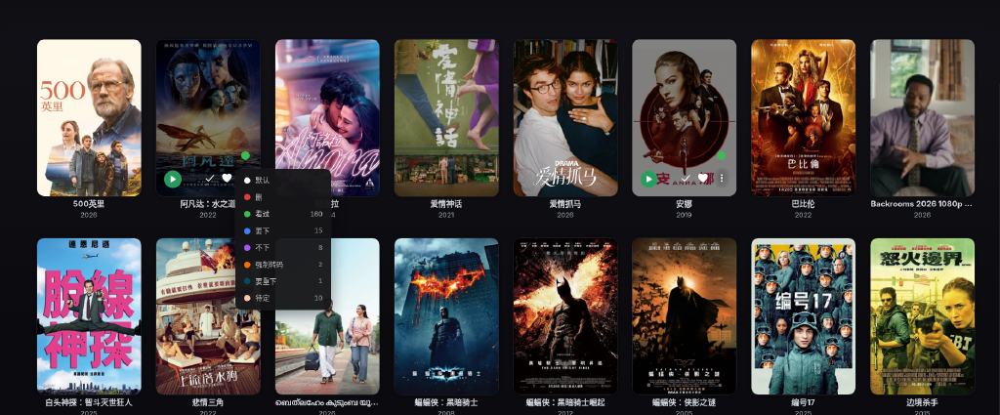
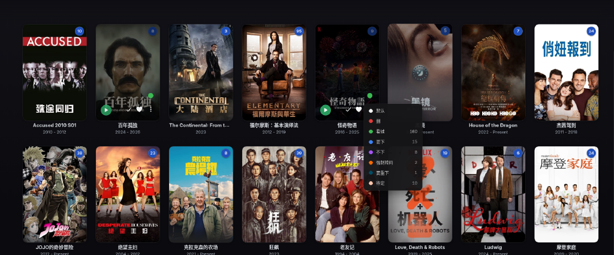

# Jellyfin Color Tags

[中文说明](README.zh-CN.md)

Colored dots for the Jellyfin web UI. Hover a poster and the dot sits above the ⋮ button. In the player it sits next to the favorite button. Give each color a name, drag the list to reorder, and optionally cap streaming bitrate or force transcode for items with that color.

English by default. Any display language that starts with `zh` (`zh-CN`, `zh-TW`, `zh-HK`, `zh-Hans`) uses Simplified Chinese. `auto` or an empty language follows the browser.

## Screenshots

Movies library grid with green color-tag dots and the tag menu open.



Series library grid with color-tag dots and the tag menu open.



## Compatibility

- Jellyfin **12** (including nyanmisaka builds that report ABI `12.0.0.0`)
- `targetAbi`: `12.0.0.0`
- Plugin id: `a7e4c1d2-6b58-4f0a-9c33-81d5e2b47a60`
- Assembly: `Jellyfin.Plugin.ColorDots.dll` (name unchanged from earlier releases)
- Tag data: `/config/colordots/assignments.json` (shared by every user)

## Install from a plugin repository

1. In Jellyfin: **Dashboard → Plugins → Repositories → Add**
2. Name it anything you like. URL:

   `https://raw.githubusercontent.com/zzzLiu/jellyfin-plugin-color-tags/main/manifest.json`

3. Open the catalog, install **Jellyfin Color Tags**, then restart Jellyfin.

Remove any older `ColorDots_*` plugin folder first. Jellyfin does not delete the previous folder; two folders with the same id can both load.

## Manual install

Download `jellyfin-color-tags_1.4.0.0.zip` from [Releases](https://github.com/zzzLiu/jellyfin-plugin-color-tags/releases).

```bash
rm -rf /config/plugins/ColorDots_* /config/plugins/ColorTags_*
mkdir -p /config/plugins/ColorTags_1.4.0.0
unzip jellyfin-color-tags_1.4.0.0.zip -d /config/plugins/ColorTags_1.4.0.0
```

Restart Jellyfin. The folder must contain `Jellyfin.Plugin.ColorDots.dll` and `meta.json` at the root of the zip.

## Use

Open **Jellyfin Color Tags** in the dashboard server menu (Chinese label: **Jellyfin 颜色标签**).

- Add a color and a name. Drag a row to reorder.
- White is the default placeholder. It is not listed under Tagged items, cannot be deleted, and is not written as an item tag.
- An item can have several colors. The dot is a solid circle for one color, equal slices for several, and white when none are on.
- Click the dot to open two columns: colors already on the item on the left, the rest on the right. Click a color to turn it on or off. The panel stays open.
- Colors are shared. Everyone sees the same dots. Turning a color on also adds its name to the item's tags. Turning it off removes that name. Other tags are left alone. Renaming or deleting a color updates those tags. Edits made in the metadata editor are not copied back.
- Each color can set a max streaming bitrate and/or Force transcode. If several colors are on, any Force transcode applies, and the lowest bitrate cap is used. Jellyfin Web can stay on Auto. Apps that open the file directly (for example Infuse) skip this.
- Tagged items show title, library, and path. Export writes a CSV.

Default names follow the interface language (White / 白, Red / 红, Green / 绿, Blue / 蓝). A name you change stays as you wrote it.

## Support

[Ko-fi](https://ko-fi.com/zzzliu)

[](https://ko-fi.com/zzzliu)

Users in China can scan the WeChat Appreciate (赞赏) QR code:


## License

MIT. See [LICENSE](LICENSE).

## Changelog

See [RELEASE_NOTES.md](RELEASE_NOTES.md).
